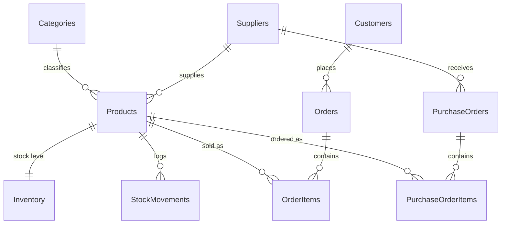

<h1 align="center">RetailStock</h1>

  <b>“Inventory and sales database for a small retailer </b> · MS SQL Server

  
  
  

---

## The problem

A small retailer loses money in two ways: **stockouts** (lost sales) and **overstock** (cash tied up in products that don't sell).

This database tracks products, stock levels, sales and supplier orders so that:

- low stock is flagged automatically, and purchase orders can be generated
- stock updates itself whenever a sale is recorded, and overselling is blocked
- slow-moving products, and the capital tied up in them, are easy to find
- sales trends and best sellers can be reported with plain SQL

## Live dashboard

**[→ rabogale-matjokotja.github.io/retailstock-mssql](https://rabogale-matjokotja.github.io/retailstock-mssql/)**

A static dashboard published with GitHub Pages. It shows revenue KPIs, weekly revenue, revenue by category, top products, items that need reordering and slow-moving stock.

## Key objects

| Object | What it does |
|---|---|
| `vw_ReorderNeeded` | Products at or below their reorder level |
| `vw_SlowMovers` | Products with no sales in 90 days, and the capital tied up in them |
| `usp_GenerateReorders` | Creates one purchase order per supplier for low-stock items, skipping products already on order |
| `trg_OrderItems_AfterInsert` | Deducts stock when a sale is recorded |

## Design decisions

| Decision | Why |
|---|---|
| **3NF schema** | Categories, suppliers and customers live in their own tables |
| **`UnitPrice` stored on `OrderItems`** | Historical sales keep the price at the time of sale, even if the product price changes |
| **`Inventory` separate from `Products`** | Stock changes constantly, product details rarely |
| **`StockMovements` audit log** | Every change in stock is traceable |
| **CHECK constraints** | Business rules enforced in the database: no negative stock, valid statuses, positive quantities |
| **Trigger plus `QtyOnHand >= 0` check** | A sale that would oversell is rolled back |
| **Indexes** | On the columns that reports filter and join on |

<b>View the data model</b>

## What's inside

| File | Purpose |
|---|---|
| `schema.sql` | Tables, constraints, indexes, trigger, views and stored procedure |
| `seed_data.sql` | Sample data: 36 products, 40 customers and about 640 orders over 13 weeks |
| `queries/dashboard_queries.sql` | The queries behind every dashboard panel, plus window-function examples |
| `docs/index.html` | The static dashboard, published with GitHub Pages |
| `gen.py` | Script that generated the sample data and the dashboard figures |

## Run it yourself

1. Run `schema.sql` in SQL Server Management Studio or Azure Data Studio.
2. Run `seed_data.sql` to load the sample data.
3. Open `queries/dashboard_queries.sql` and run the queries one at a time.

---

  Part of my portfolio · <a href="https://rabogale-matjokotja.github.io">rabogale-matjokotja.github.io</a>

